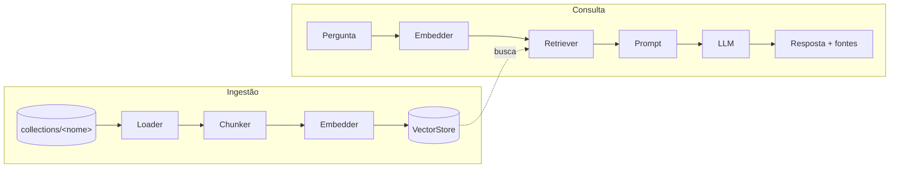
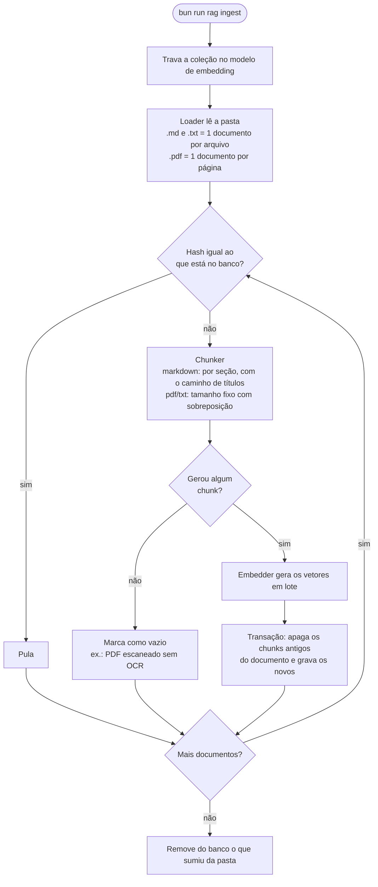
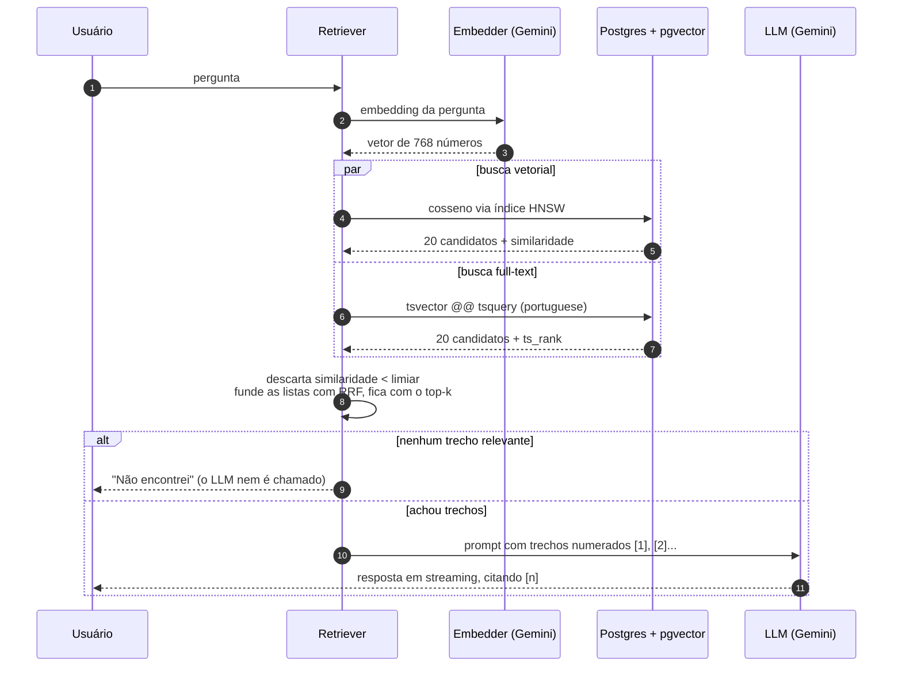
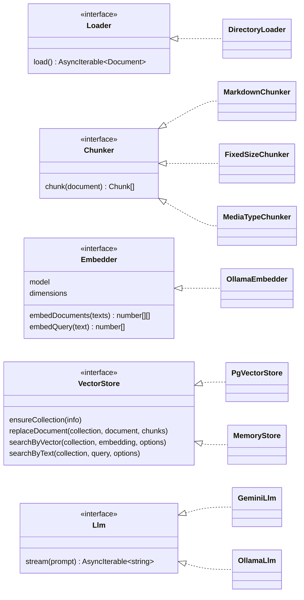
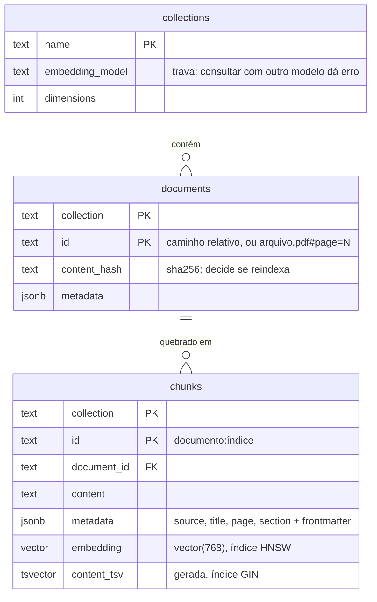

# Arquitetura

Um RAG tem duas fases. A **ingestão** roda quando os documentos mudam: lê, quebra em pedaços, transforma cada pedaço num vetor e guarda. A **consulta** roda a cada pergunta: busca os pedaços mais relevantes e entrega só eles ao LLM.

## Visão geral



## Ingestão

O sync é incremental: cada documento tem um hash do conteúdo, e só o que mudou passa pelo embedder.



## Consulta

A busca é híbrida. A vetorial acha trechos pelo significado, mesmo sem palavras em comum com a pergunta. A full-text acha termos exatos, como códigos de erro (`PAG-402`), em que a vetorial costuma falhar. As duas listas são fundidas com RRF.



### Por que RRF

O score da busca vetorial (cosseno, de 0 a 1) e o da full-text (`ts_rank`, sem teto) não estão na mesma escala, então somar os dois não faz sentido. O Reciprocal Rank Fusion usa só a **posição** de cada trecho em cada lista:

```
score(trecho) = Σ  1 / (60 + posição na lista)
```

Quem aparece bem colocado nas duas listas sobe.

## Camadas e interfaces

Cada caixa é uma interface de `src/core/types.ts`. O `src/rag.config.ts` escolhe as implementações; o resto do código só conhece as interfaces.



## Modelo de dados



## Decisões e por quês

| Decisão | Motivo |
|---|---|
| Postgres + pgvector, tabela única | Um banco só faz busca vetorial, full-text, filtro por `jsonb` e transação. A dimensão do vetor é fixa na coluna, então trocar de modelo de embedding exige recriar o banco. |
| PDF dividido por página | A citação aponta a página certa. |
| Prefixo com o caminho de títulos no chunk de markdown | Um trecho como "clique em Confirmar" sozinho perde o assunto, e o embedding fica genérico. |
| Limiar de similaridade antes da fusão | A busca vetorial sempre devolve *alguma coisa*. Sem limiar, uma pergunta fora do assunto recebe os trechos "menos distantes" e o LLM inventa. |
| Sem trecho relevante, não chama o LLM | Economiza chamada e elimina a chance de alucinação. |
| `hnsw.iterative_scan = strict_order` | O HNSW filtra depois de achar os vizinhos. Com várias coleções na mesma tabela, o filtro por coleção poderia sobrar com menos resultados que o pedido. |
